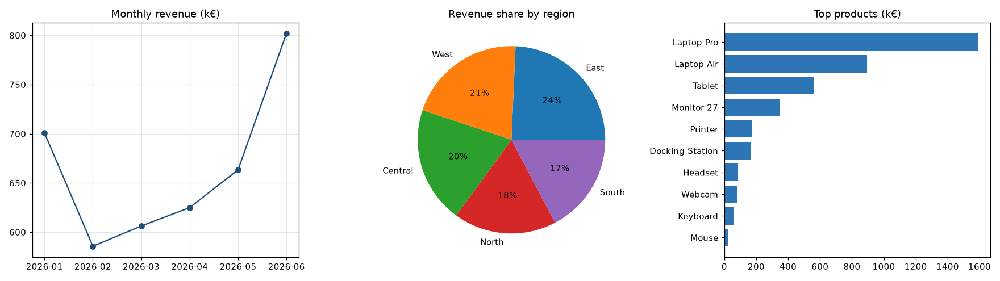
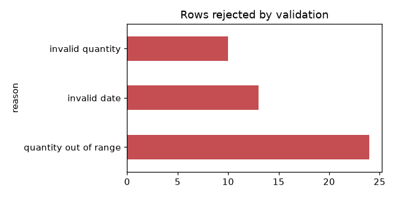

# Excel Sales Report Automation

A documented, tested Python CLI that turns a folder of **messy sales exports** (CSV and Excel, different column names, separators, number and date formats) into a **formatted Excel report with native charts**, plus a full audit log, in one command.



## Problem
Teams often spend hours every month copy-pasting exports from different systems into one spreadsheet, fixing formats by hand and rebuilding the same charts. It's slow and error-prone.

## What the tool does
1. **Ingest:** reads every `*.csv`, `*.xlsx` and `*.xls` in a folder; auto-detects `,`/`;` separators; maps different header names (`fecha`, `Order Date`, `qty`, `AREA`…) to a standard schema via `config.yaml`. Files missing required columns are skipped and logged, not crashed on.
2. **Clean and validate:** parses European (`1.234,50`) and US (`1,234.50`, `€ 12.5`) numbers, ISO and day-first dates, trims and normalises text, removes duplicates. Invalid rows (impossible dates, negative quantities, blanks) go to a **Rejected Rows** sheet with the reason.
3. **Aggregate:** KPIs, monthly trend, revenue by region with share, top-N products, month × region pivot.
4. **Report:** a styled multi-sheet workbook (header colours, currency formats, frozen panes) with **native Excel line, pie and bar charts** on the Summary sheet.
5. **Log:** timestamped log file in `logs/` for every run.

## Results on the included sample data
Run on 5 sample files (1,178 raw rows, Jan–Jun 2026):

| | |
|---|---|
| Files read / skipped | 4 / 1 (`broken_export.csv`, missing columns) |
| Clean rows | **1,123** |
| Rejected rows | **47** (24 quantity out of range, 13 invalid dates, 10 invalid quantities) |
| Duplicates removed | 8 |
| Total revenue | **€3,983,193.30** |
| Runtime | < 1 second |
| Tests | **17 passed** (`pytest`) |



> **Data note:** the sample input files are **synthetic**, produced by `scripts/make_sample_data.py` (seeded) with realistic messiness injected on purpose. No real company data is used.

## Quick start
```bash
pip install -r requirements.txt
python -m sales_report.cli --input sample_data/input --output output/sales_report.xlsx
pytest -q
```
See **[docs/USAGE.md](docs/USAGE.md)** for all options, configuration and how to adapt it to your own files.

## Structure
```
sales_report/
  cli.py        command-line entry point and logging
  config.py     YAML config loader
  ingest.py     file discovery, reading, header mapping
  clean.py      parsing, validation, de-duplication
  aggregate.py  KPI and summary tables
  report.py     formatted Excel output and charts
config.yaml     column aliases, validation rules, report settings
tests/          pytest suite (unit + end-to-end)
scripts/        sample-data generator and README chart previews
```
